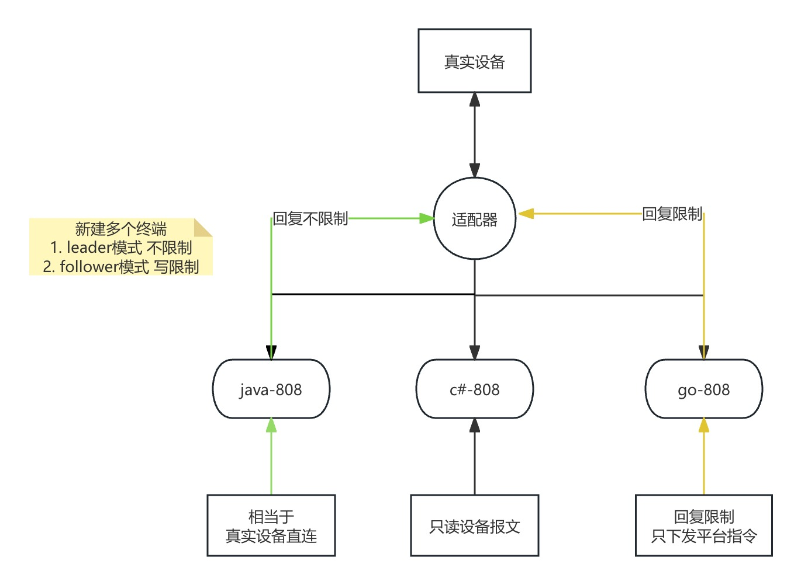

# 适配器

## 设计参考


1. 真实设备连接到适配器
2. 适配器向多个后端 808 服务发起模拟连接（上行扇出转发）
- **Leader 模式**：相当于真实设备直连，后端下发的任何指令均可写回真实设备
- **Follower 模式**：服务读正常，写受白名单控制 —— 允许下发「全局默认允许列表 `AllowCommand`」与「该节点 `Terminal.AllowCommands`」的并集指令，其余指令（如 `0x8001` 通用应答、`0x8100` 注册应答）丢弃不写回设备
3. 真实设备断开（或触发空闲超时、写超时、`Adapter.Stop()`）时，对应的后端模拟连接全部断开；单个后端模拟连接断开或拆包异常时，按 `TimeoutRetry` 间隔自动重连

### Follower 默认全局放行指令
未调用 `adapter.WithAllowCommand(...)` 覆盖时，Follower 默认全局允许向设备下发以下平台主动指令：
- **基础控制与补传**：`0x8003`（补传分包请求）、`0x8103`（设置终端参数）、`0x8104`（查询终端参数）、`0x8801`（摄像头立即拍摄命令）
- **JT1078 音视频**：`0x9003`（查询终端音视频属性）、`0x9101`（实时音视频传输请求）、`0x9102`（音视频实时传输控制）、`0x9205`（查询资源列表）、`0x9207`（文件上传控制）
- **主动安全扩展**：`0x9208`（报警附件上传指令）

> 若希望禁用全局默认放行列表、仅允许各 Follower 节点通过 `Terminal.AllowCommands` 显式指定的指令，可传入空的 `adapter.WithAllowCommand()`。

## Option 配置项

| 配置函数 | 默认值 | 说明 |
| --- | --- | --- |
| `WithHostPorts(addr)` | `"0.0.0.0:18080"` | 适配器监听地址 |
| `WithTerminals(terminals...)` | 空 | 转发目标后端列表（`Leader` / `Follower` 及各自额外放行的 `AllowCommands`） |
| `WithAllowCommand(cmds...)` | 上述 10 条默认指令 | 覆盖全局 Follower 允许下发的指令列表（传空则清空全局默认列表） |
| `WithDialTimeout(timeout)` | `10s` | 连接后端 808 服务的 TCP 拨号超时时间 |
| `WithTimeoutRetry(timeout)` | `10s` | 后端 808 服务连接断开后的重连等待间隔 |
| `WithWriteTimeout(timeout)` | `10s` | 单次 TCP 写超时时间（真实终端与后端连接均生效，超时断开连接） |
| `WithIdleTimeout(timeout)` | `0`（不启用） | 真实终端连接的读空闲超时时间，超时未收到上行数据则断开会话 |
| `WithMaxFrameBufferSize(size)` | `2048 * 2` (`4096`) | 下行粘包缓冲区最大未闭合字节数（如 `0x7e...` 未闭合或非 `0x7e` 异常流），达到即断开该后端连接并重连（`<= 0` 不限制） |

## 使用案例
- [代码参考](../example/adapter/main.go)

```go
func main() {
	address := "0.0.0.0:18080"
	adapterGroup := adapter.New(
		adapter.WithHostPorts(address),
		// adapter.WithAllowCommand(), // 传空可关闭全局默认放行列表，仅使用下方 Terminal.AllowCommands
		adapter.WithDialTimeout(10*time.Second),  // 连接后端 808 服务的拨号超时
		adapter.WithTimeoutRetry(10*time.Second), // 模拟连接断开后 多久重试一次
		adapter.WithTerminals(
			adapter.Terminal{
				Mode:       adapter.Leader,    // 服务和设备之间读写全部正常
				TargetAddr: "127.0.0.1:18081", // 其他项目的jt808服务
			},
			adapter.Terminal{
				Mode:       adapter.Follower,  // 服务读正常 写仅放行全局 AllowCommand + 当前 AllowCommands
				TargetAddr: "127.0.0.1:18082", // go-jt808项目的jt808服务
				AllowCommands: []consts.JT808CommandType{
					consts.P9205QueryResourceList, // 额外指定允许向设备发送的命令
				},
			},
		),
	)
	adapterGroup.Run()
}
```

## 测试案例
1. 真实设备连接到适配器
2. leader关闭 follower正常的情况
- 此时真实设备不会收到默认回复（如 `0x8001` / `0x8100`）
- 真实设备可收到允许的指令 如 `0x9205`
3. leader的808服务开启
- 真实设备收到默认回复

```txt
7e010200090000000010010002393837363534333231287e
7e8001000500000000100100000002010201957e
7e010000300000000010010001001f006e63643132337777772e3830382e636f6d0000000000000000003736353433323101b2e2413132333435363738697e
7e81000007000000001001000100010031303031977e
7e010200090000000010010002393837363534333231287e
7e8001000500000000100100020002010201977e
7e920500180000000010010003012412091636532412101636530000000000000000000000857e
7e1205002200000000100100000003000000010124110200000024110200010200000000000004000101010000000b2a7e
7e000200000000000010010003107e
7e000200000000000010010003107e
7e000200000000000010010003107e
7e000200000000000010010003107e
7e000200000000000010010003107e
7e8001000500000000100100000003000200947e
7e000200000000000010010003107e
7e8001000500000000100100010003000200957e
7e000200000000000010010003107e
7e8001000500000000100100020003000200967e
7e000200000000000010010003107e
7e8001000500000000100100030003000200977e
```
