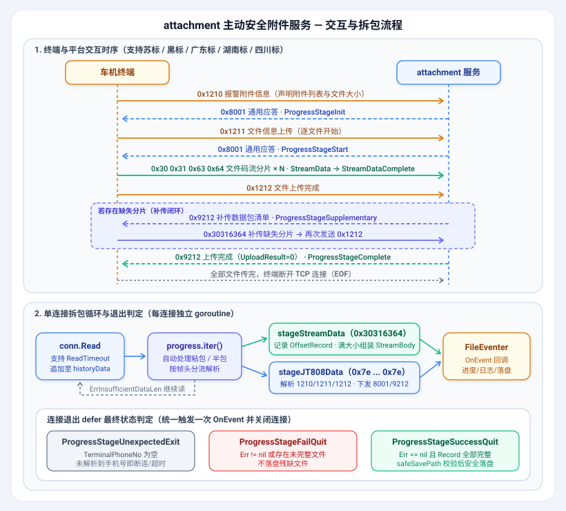
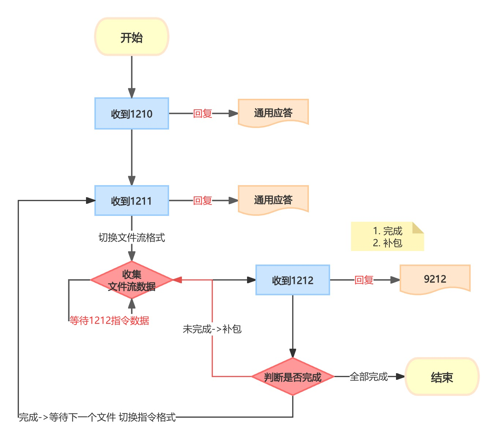

# 主动安全附件服务 (`attachment`)

独立运行的主动安全附件 TCP 接收服务，负责处理终端上报的报警附件指令（`0x1210` / `0x1211` / `0x1212`）与文件码流分片（`0x30 0x31 0x63 0x64`），支持多地标（苏标、黑标、广东标、湖南标、四川标）与缺包补传（`0x9212`）。

## 设计概览

每个终端连接由独立 goroutine 驱动，无跨连接共享状态：

| 文件 | 职责 |
| --- | --- |
| `service.go` / `option.go` | TCP 监听入口 `GoJT808`，通过 `Option` 配置地址、地标类型、读超时、自定义协议/事件处理器 |
| `connection.go` | 单连接读写循环、超时控制、回复下发及退出阶段判定 |
| `package.go` | 粘包/拆包迭代器 `PackageProgress.iter()`、分片记录、缺包区间统计 `StatisticalMissSegments()` 与文件组装 |
| `jt808_data_handle.go` | JT808 指令分发（`0x1210`/`0x1211`/`0x1212`）与应答生成（`0x8001`/`0x9212`） |
| `stream_data_handle.go` | 流数据包头解析：通用 50 字节定长文件名（苏标等）与变长文件名（黑标） |
| `file_event.go` / `progress_stage.go` | 生命周期阶段定义与默认事件实现（含路径穿越安全校验 `safeSavePath`） |

## 交互与解析流程



### 报文格式参考



## 快速开始

```go
package main

import (
	"log/slog"
	"os"
	"time"

	"github.com/cuteLittleDevil/go-jt808/attachment"
	"github.com/cuteLittleDevil/go-jt808/shared/consts"
)

func init() {
	logger := slog.New(slog.NewJSONHandler(os.Stdout, &slog.HandlerOptions{
		AddSource: true,
		Level:     slog.LevelDebug,
	}))
	slog.SetDefault(logger)
}

func main() {
	attach := attachment.New(
		attachment.WithNetwork("tcp"),
		attachment.WithHostPorts("0.0.0.0:10001"),
		attachment.WithActiveSafetyType(consts.ActiveSafetyJS), // 默认苏标，支持黑标/广东标/湖南标/四川标
		attachment.WithReadTimeout(30*time.Second),             // 可选：单次读超时，<= 0 表示不限制
		// attachment.WithFileEventerFunc(func() attachment.FileEventer {
		// 	// 自定义文件事件处理（初始化、传输中、补传、完成、退出等）
		// 	// 默认按 ./<手机号>/<文件名> 安全落盘
		// 	return &meFileEvent{}
		// }),
	)
	attach.Run()
}
```

## 参考示例

* **本地模拟上传**：[example/attachment/local/main.go](../example/attachment/local/main.go) — 启动附件服务并模拟终端上传指定目录文件（含缺包补传）。
* **苏标完整联动**：[example/attachment/su_biao/main.go](../example/attachment/su_biao/main.go) — 设备接入 808 服务，检测到苏标告警后下发 `0x9208` 触发附件上传。
* **独立部署服务**：[example/attachment/attach/main.go](../example/attachment/attach/main.go) — 带配置文件与 HTTP 事件回调的附件接收服务。
