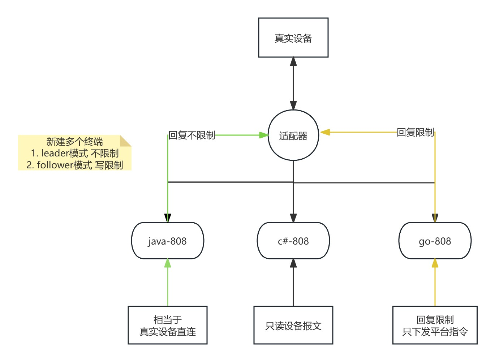

# 适配器



## 工作原理

1. 真实设备连接到适配器
2. 适配器向多个 808 服务发起模拟连接：
   - `Leader` 模式：相当于真实设备直连，服务和设备之间读写全部正常
   - `Follower` 模式：控制 808 服务下发到真实设备的指令（允许下发全局默认 `AllowCommand` 如 `0x8003`/`0x8103`/`0x9101` 等 10 条指令 + 节点自身的 `AllowCommands`；传空 `adapter.WithAllowCommand()` 可清空全局默认列表）
3. 真实设备断开则模拟连接全部断开；某个模拟连接断开则按 `WithTimeoutRetry` 间隔自动重试

## 目录说明

- [main.go](./main.go)：启动适配器（`18080`）、Leader 服务（`18081`）、Follower 服务（`18082`）并演示断线重连与指令放行
- [client.go](./client.go)：模拟真实终端连接适配器
- [terminal.go](./terminal.go)：服务端终端生命周期事件日志

## 运行方式

无需外部依赖，直接运行即可观察完整流程：

```bash
cd example/adapter
go run .
```

- [代码参考](./main.go)

``` go
func main() {
	address := "0.0.0.0:18080"
	adapterGroup := adapter.New(
		adapter.WithHostPorts(address),
		//adapter.WithAllowCommand(), // 传空可关闭全局默认放行列表，仅使用下方 Terminal.AllowCommands
		adapter.WithTimeoutRetry(10*time.Second), // 模拟连接断开后 多久重试一次
		adapter.WithTerminals(
			adapter.Terminal{
				Mode:       adapter.Leader,    // 服务和设备之间读写全部正常
				TargetAddr: "127.0.0.1:18081", // 其他项目的jt808服务
			},
			adapter.Terminal{
				Mode:       adapter.Follower,  // 服务读正常 写仅放行全局默认 AllowCommand + 当前 AllowCommands
				TargetAddr: "127.0.0.1:18082", // go-jt808项目的jt808服务
				AllowCommands: []consts.JT808CommandType{
					consts.P9205QueryResourceList, // 额外允许向设备发送的命令
				},
			},
		),
	)
	adapterGroup.Run()
}

```

1. 真实设备连接到适配器
2. leader关闭 follower正常的情况
- 此时真实设备不会收到默认回复
- 真实设备可收到允许的指令 如0x9205
3. leader的808服务开启
- 真实设备收到默认回复

``` txt
7e010200090000000010010002393837363534333231287e
7e8001000500000000100100000002010201957e
7e010000300000000010010001001f006e63643132337777772e3830382e636f6d0000000000000000003736353433323101b2e2413132333435363738697e
7e81000007000000001001000100010031303031977e
7e010200090000000010010002393837363534333231287e
7e8001000500000000100100020002010201977e
7e920500180000000010010003012412091636532412101636530000000000000000000000857e
7e1205002200000000100100000003000000010124110200000024110200010200000000000004000101010000000b2a7e
7e000200000000000010010003107e
7e000200000000000010010003107e
7e000200000000000010010003107e
7e000200000000000010010003107e
7e000200000000000010010003107e
7e8001000500000000100100000003000200947e
7e000200000000000010010003107e
7e8001000500000000100100010003000200957e
7e000200000000000010010003107e
7e8001000500000000100100020003000200967e
7e000200000000000010010003107e
7e8001000500000000100100030003000200977e

```
