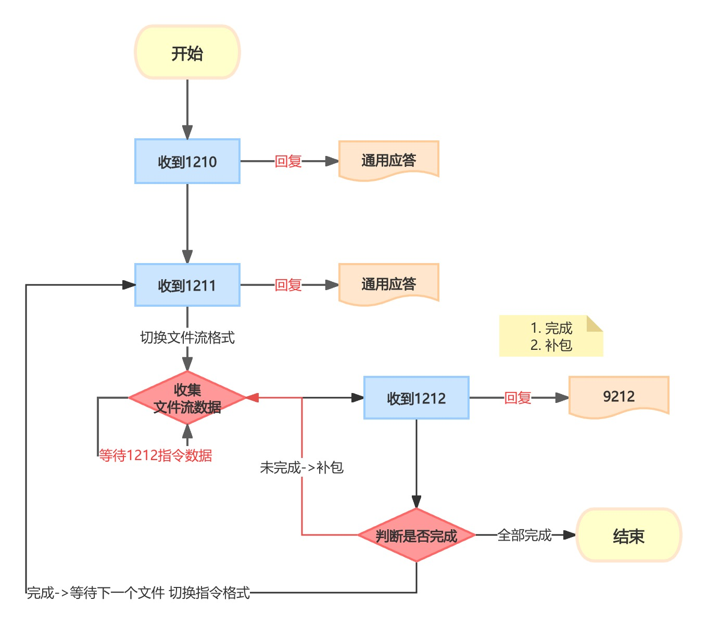

# 主动安全



## 目录说明

| 子目录 | 说明 | 运行方式 |
| --- | --- | --- |
| [local](./local) | 本地自包含演示：启动附件服务并用模拟器上传指定目录下的文件 | `go run ./local` |
| [su_biao](./su_biao) | 苏标完整对接示例：808 服务检测到苏标告警后自动下发 `0x9208` 触发附件上传 | `go run ./su_biao` |
| [attach](./attach) | 独立可配置附件服务（单独 Go 模块），支持本地保存与 HTTP 状态回调 | `cd attach && go run .` |

## 1. 本地模拟上传

- [代码参考](./local/main.go)

```bash
cd example/attachment
go run ./local
```

``` txt
1 启动主动安全附件服务
2 自定义模拟器把dir目录下的文件都上传
```

<h2 id="sb"> 2. 苏标对接 </h2>

- [代码参考](./su_biao/main.go)

```bash
cd example/attachment
go run ./su_biao
```

``` txt
1 设备连接到808服务
2 自定义终端事件 检测到苏标告警后发送9208指令
3 设备开始上传文件 本地./file.log中显示进度
```

<h2 id="ex"> 3. 独立附件服务示例 </h2>

- [代码参考](./attach/main.go) | [回调报文详情](./attach/README.md)

```bash
cd example/attachment/attach
go run .
```

``` txt
1 修改配置文件 config.yaml (实际只测试了苏标 其他标准有问题提issues)
2 设备上传成功后保存到本地 (可实现回调自定义保存 默认保存本地)
3 在设备上传的过程中触发http回调事件 包括开始 数据收集中 完成等事件
```