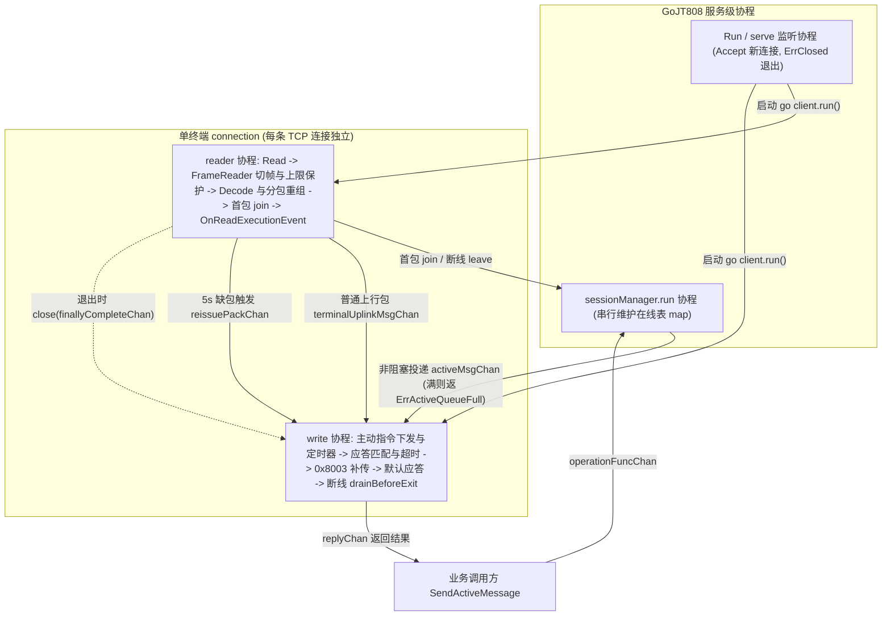
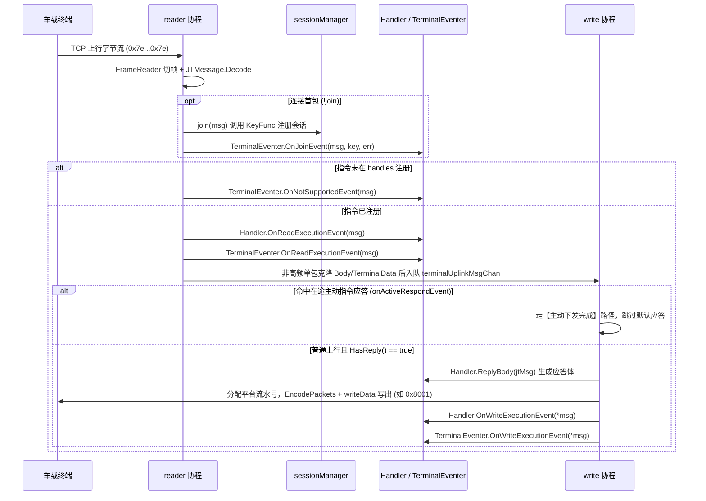
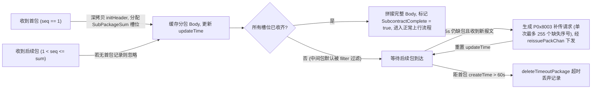
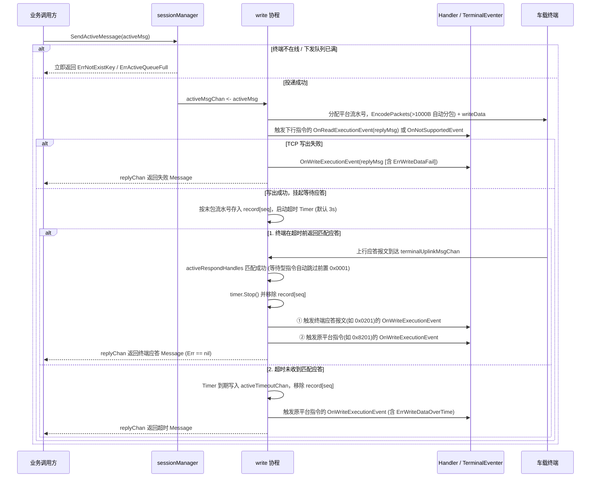

# JT808 核心通信服务 (`service`)

`service` 包是 `go-jt808` 的 TCP 服务端核心实现，负责终端长连接接入、粘包切帧与分包重组、无锁会话路由、上下行指令自动应答、平台主动下发（带超时与应答匹配）以及连接全生命周期事件回调。

## 模块文件职责

| 文件 | 职责 |
| --- | --- |
| [service.go](./service.go) | 服务入口 `GoJT808`（`New` / `Run` / `SendActiveMessage`），组装默认指令处理器与主动应答匹配器 |
| [option.go](./option.go) | 函数式配置项 `Option`（监听地址、分包过滤、空闲读超时、粘包缓冲上限、自定义 Key 与事件回调） |
| [session_manager.go](./session_manager.go) | 单协程无锁会话管理器，串行维护在线终端表 `map[key]*session` 并路由主动下发请求 |
| [connection.go](./connection.go) | 单终端长连接会话，由 `reader` 与 `write` 双协程协作驱动上下行全流程 |
| [packet_parse.go](./packet_parse.go) | TCP 字节流切帧解码、多包分包缓存重组、`5s` 缺包补传请求（`0x8003`）生成与 `60s` 超时淘汰 |
| [handle.go](./handle.go) | `Handler`、`JT808Handler`、`TerminalEventer`、`Eventer` 扩展接口与默认实现 |
| [message.go](./message.go) | 上下行统一载体 `Message` 及其扩展上下文 `ExtensionFields` |
| [active_message.go](./active_message.go) | 平台主动下发请求对象 `ActiveMessage` |
| [error.go](./error.go) | 导出错误定义（`ErrNotExistKey`、`ErrActiveQueueFull`、`ErrWriteDataFail`、`ErrWriteDataOverTime`） |

---

## 协程模型与整体执行流程

服务端采用 **“1 个全局会话管理协程 + 每个终端连接 2 个独立协程（`reader` / `write`）”** 的无锁架构，所有跨协程交互均通过有界 Channel 完成：



### 连接级关键保护机制
1. **粘包缓冲上限保护**：终端发送未闭合的 `0x7e...` 数据或非 `0x7e` 异常字节流时，`FrameReader.Pending()` 达到 `MaxFrameBufferSize`（默认 `1023 * 2 = 2046` 字节）会立即断开连接，防止异常连接无限占用内存。
2. **慢终端隔离**：`sessionManager` 向终端 `activeMsgChan`（容量 10）投递主动消息时采用非阻塞 `select`，单个终端网络淤塞满队列时立即向调用方返回 `ErrActiveQueueFull`，绝不阻塞其他终端的上下线与指令下发。
3. **写超时主动断连**：所有下行写操作均经过 `writeData` 设置写截止时间（默认 `10s`），发生 `os.ErrDeadlineExceeded` 时主动关闭底层连接，唤醒 `reader` 走标准下线清理流程。

---

## 指令的生命周期

`service` 中的指令按流向与分包形态分为三类生命周期，统一以 `*Message` 贯穿事件回调。

### 一、终端主动上行指令生命周期（单包）

典型指令：`0x0002`（心跳）、`0x0100`（注册）、`0x0102`（鉴权）、`0x0200`（位置上报）。



**阶段细节与约定：**
- **按需解析约定**：框架解码仅解析消息头（`Header`）并校验异或码，**不会自动调用 `Handler.Parse`**。业务若需读取报文体字段，应在 `OnReadExecutionEvent` 中显式调用 `_ = h.Parse(msg.JTMessage)`。
- **零拷贝复用约定**：高频指令（`0x0002` 心跳、`0x0200` 位置、`0x0704` 批量位置）为了降低 GC 压力不拷贝读缓冲；在 `OnReadExecutionEvent` 外异步持有或在 `OnWriteExecutionEvent` 中访问 `Body` / `TerminalData` 前，须在读事件中自行深拷贝。

---

### 二、分包上行与 `0x8003` 补传生命周期

典型指令：`0x0801`（多媒体数据上传）等 `Header.SubPackageSum > 0` 的多包报文。



**阶段细节：**
1. **首包为准**：仅当 `seq == 1` 到达时创建分包记录（若同指令 ID 存在未完成的旧记录则覆盖）；首包丢失时后续孤儿分包直接忽略。`add` 时会深拷贝初始 `Header`，避免后续补传改写污染已分发的首包消息。
2. **分包过滤（`WithHasSubcontract`）**：默认 `true`。未重组完成的中间分包不会触发 `OnReadExecutionEvent`、`OnWriteExecutionEvent` 及默认应答；重组完成后的总包携带完整 `Body` 触发一次完整读写生命周期。
3. **`255` 分批补传**：`0x8003` 的重传包总数字段为 `BYTE`（上限 `255`），当缺失分包超过 `255` 个时单次最多请求前 `255` 个，剩余缺失序号在后续 `5s` 周期继续补传。

---

### 三、平台主动下发指令生命周期（`SendActiveMessage`）

典型指令：`0x8103`（设置参数）、`0x8201`（位置查询 → `0x0201`）、`0x8801`（立即拍摄 → `0x0001` 跳过 → `0x0805`）。



**阶段细节：**
1. **两阶段应答跳过机制（`isWaitingCommand`）**：对于 `0x8801`（立即拍摄）、`0x9003`（查音视频属性）、`0x9205`（查资源列表）、`0x9206`（文件上传指令），终端往往先回一条 `0x0001` 通用应答表示“收到指令”，随后再上报真正的业务结果（`0x0805` / `0x1003` / `0x1205` / `0x1206`）。默认匹配器会自动忽略这些指令的前置 `0x0001`，保持定时器继续等待最终业务报文。
2. **多分包下行匹配**：当主动下发 `Body > 1000` 字节时，`EncodePackets` 自动拆分为多个分包并递增平台流水号，`record` 以**最后一包的流水号**登记等待终端应答。
3. **连接断开排空收尾（`drainBeforeExit`）**：当连接在等待应答期间断开时，`reader` 关闭 `finallyCompleteChan`，`write` 协程退出前严格按三步收尾：
   - 先排空 `terminalUplinkMsgChan`，若终端断线前已发回匹配应答则优先正常完成；
   - 再排空 `activeMsgChan`，对尚未发出的指令执行发送（因连接已关，立即以 `ErrWriteDataFail` 收尾返回）；
   - 最后等待 `record` 中剩余在途请求超时归零并逐一写入 `replyChan`，保证业务侧阻塞调用的 `SendActiveMessage` 必定返回，不会永久挂起。

---

## 配置项与错误码速查

### Option 配置项

| 配置函数 | 默认值 | 说明 |
| --- | --- | --- |
| `WithHostPorts(addr)` | `"0.0.0.0:808"` | TCP 监听地址 |
| `WithNetwork(network)` | `"tcp"` | 网络协议类型 |
| `WithKeyFunc(fn)` | `Header.TerminalPhoneNo` | 自定义终端唯一会话标识（返回 `ok=false` 时暂不注册会话但保持连接继续处理报文，待后续报文返回 `ok=true` 再上线；若 `key` 已在线则断开重复连接） |
| `WithHasSubcontract(filter)` | `true` | 是否过滤未重组完成的中间分包读写事件与默认回复 |
| `WithMaxFrameBufferSize(size)` | `1023 * 2` (`2046`) | 粘包缓冲区最大未闭合字节数，达到即断开连接（`<= 0` 不限制） |
| `WithTerminalTimeout(idle, fn)` | `0`（关闭） | 读空闲超时时长及超时回调 `func(TerminalTimeout)` |
| `WithCustomTerminalEventer(fn)` | `defaultTerminalEvent` | 自定义连接级事件（每个新连接调用一次工厂函数创建独立实例） |
| `WithCustomHandleFunc(fn)` | 空 | 覆盖或扩展单连接指令处理器 `map[JT808CommandType]Handler` |
| `WithCustomActiveRespondHandlerFunc(fn)` | 空 | 自定义主动下发应答匹配规则 |

### 常见导出错误

| 错误变量 | 触发场景 |
| --- | --- |
| `ErrNotExistKey` | 调用 `SendActiveMessage` 时目标 `Key` 未在线或已下线 |
| `ErrActiveQueueFull` | 目标终端 `activeMsgChan`（容量 10）已满，通常因终端网络阻塞导致写协程积压 |
| `ErrWriteDataFail` | 向底层 `net.Conn` 写出数据失败或触发 `10s` 写超时 |
| `ErrWriteDataOverTime` | 平台主动下发指令写出成功，但在 `OverTimeDuration`（默认 `3s`）内未收到匹配的终端应答 |

---

## 快速开始

```go
package main

import (
	"log/slog"
	"time"

	"github.com/cuteLittleDevil/go-jt808/protocol/model"
	"github.com/cuteLittleDevil/go-jt808/service"
	"github.com/cuteLittleDevil/go-jt808/shared/consts"
)

type myLocation struct {
	model.T0x0200
}

func (l *myLocation) OnReadExecutionEvent(msg *service.Message) {
	if err := l.Parse(msg.JTMessage); err != nil {
		slog.Warn("parse 0x0200 fail", slog.Any("err", err))
		return
	}
	slog.Info("location",
		slog.String("key", msg.Key),
		slog.Float64("lat", float64(l.Latitude)/1e6),
		slog.Float64("lng", float64(l.Longitude)/1e6))
}

func (l *myLocation) OnWriteExecutionEvent(_ service.Message) {}

func main() {
	goJt808 := service.New(
		service.WithHostPorts("0.0.0.0:8080"),
		service.WithMaxFrameBufferSize(1023*2),
		service.WithTerminalTimeout(60*time.Second, func(t service.TerminalTimeout) {
			slog.Info("idle timeout", slog.String("key", t.Key), slog.String("addr", t.Address))
		}),
		service.WithCustomHandleFunc(func() map[consts.JT808CommandType]service.Handler {
			return map[consts.JT808CommandType]service.Handler{
				consts.T0200LocationReport: &myLocation{},
			}
		}),
	)
	go goJt808.Run()

	// 终端上线后可主动下发查询位置（超时 3 秒）
	reply := goJt808.SendActiveMessage(
		service.NewActiveMessage("12345678901", consts.P8201QueryLocation, nil, 3*time.Second),
	)
	if reply.ExtensionFields.Err != nil {
		slog.Warn("active send fail", slog.Any("err", reply.ExtensionFields.Err))
	}
}
```
